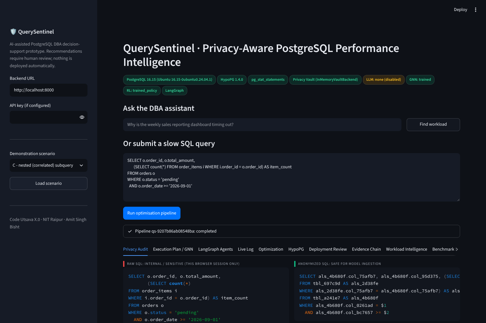
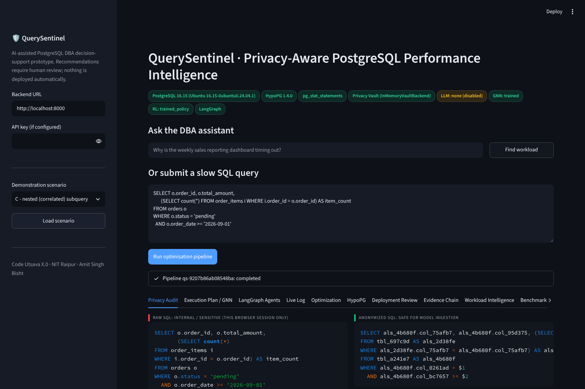
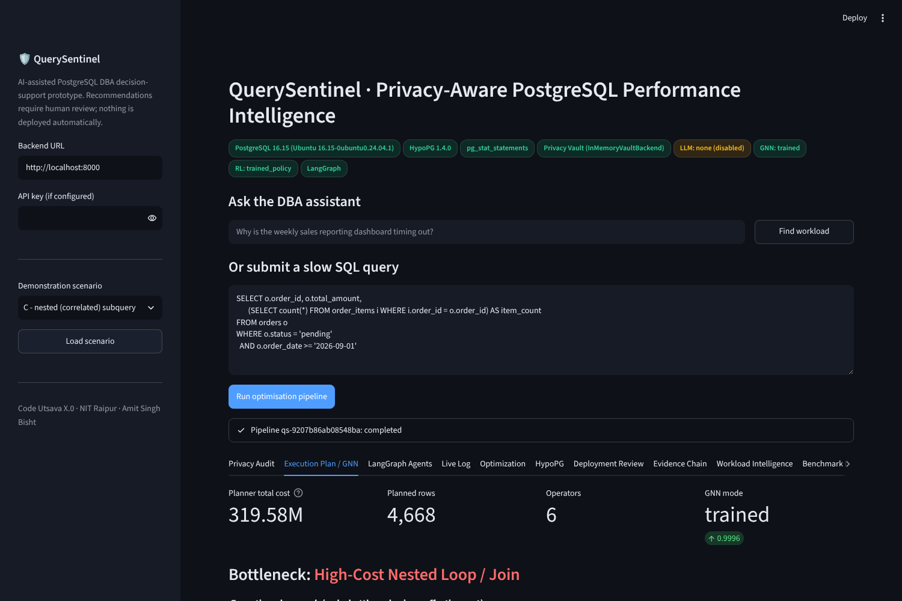
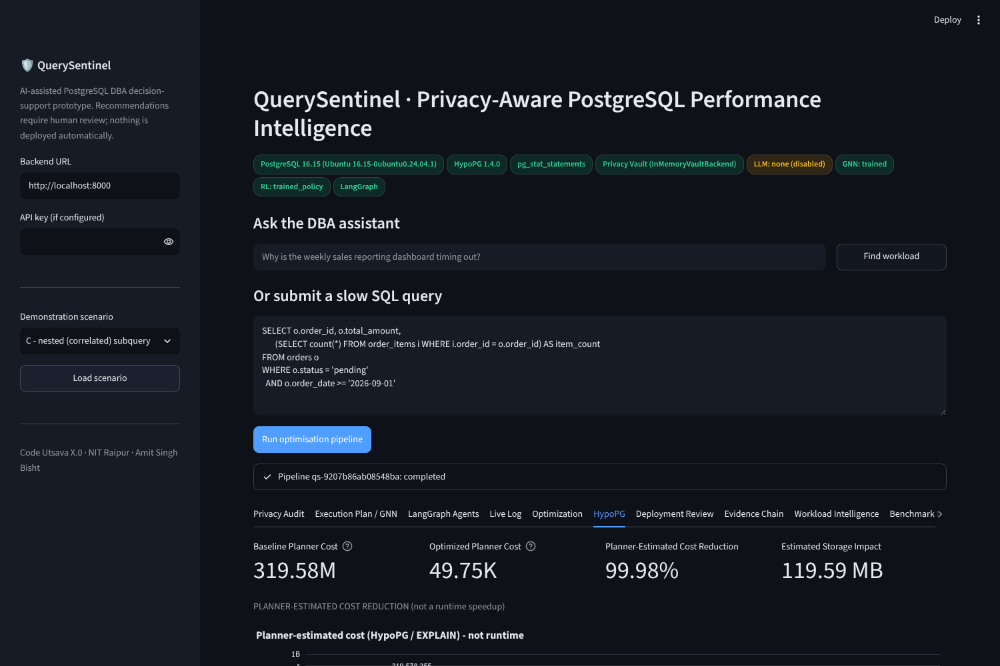

# QuerySentinel

**Privacy-aware AI optimizer for PostgreSQL queries.** It tells a DBA why a query is slow and how to fix it, without sending customer data or real schema names to an AI model.

Finalist, Code Utsava X.0 (NIT Raipur) · Author: [Amit Singh Bisht](https://github.com/AmitSingh-23)



## What it does

1. **Masks the query first.** Literals become `$1, $2, …` (pglast AST) and table and column names become HMAC-SHA256 pseudonyms. An outgoing-payload guard blocks any AI call that still contains raw values.
2. **Diagnoses the plan.** `EXPLAIN (FORMAT JSON)` runs in a read-only transaction. The plan tree is analysed by a small GNN, with a deterministic rule-based fallback.
3. **Proposes fixes.** LangGraph agents suggest indexes, SQL rewrites and partitioning, and a tabular Q-learning policy ranks them.
4. **Tests before recommending.** Every index is simulated with HypoPG hypothetical indexes, and write and storage impact is estimated.
5. **Hands over to a human.** The output is a migration script plus rollback. Nothing is deployed automatically.

| Privacy masking | Plan analysis | HypoPG simulation |
| --- | --- | --- |
|  |  |  |

## Status and limits

This is a hackathon prototype for decision support, not a production tool.

- Cost reductions are **PostgreSQL planner estimates**, not measured runtimes, unless stated otherwise.
- The GNN is trained on synthetic, PostgreSQL-shaped plans.
- PII detection is pattern-based and not exhaustive.

## Run it

```bash
cd db-opt-platform
cp .env.example .env      # set passwords
docker compose up --build
```

Then open the API health check at `http://localhost:8000/api/v1/health` and the dashboard at `http://localhost:8501`.

Run the tests with:

```bash
cd db-opt-platform
pytest
```

## Documentation

- Full documentation: [`db-opt-platform/README.md`](db-opt-platform/README.md)
- Architecture: [`db-opt-platform/docs/architecture.md`](db-opt-platform/docs/architecture.md)
- Security model: [`db-opt-platform/docs/security.md`](db-opt-platform/docs/security.md)
- API reference: [`db-opt-platform/docs/api.md`](db-opt-platform/docs/api.md)

**Stack:** Python, FastAPI, PostgreSQL 16, HypoPG, pglast, LangGraph, PyTorch Geometric, Streamlit, Docker
